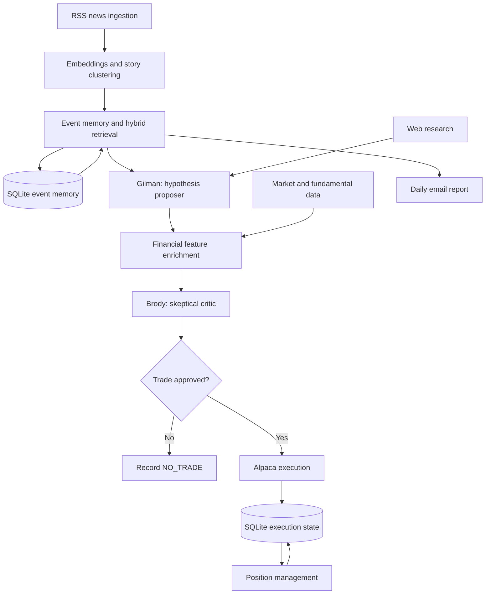

# Adversarial-LLM Investing System

A **retrieval-augmented generation (RAG)** system for event-driven equity research and trading. The pipeline turns news coverage into distinct stories, connects those stories to persistent event memory, and uses a **proposer–critic LLM architecture** to generate and challenge investment hypotheses before execution.

The central research question is whether historical context and adversarial review can help distinguish actionable developments from repeated coverage and persuasive but weak investment narratives.

**Core methods:** NLP · text embeddings · hierarchical clustering · hybrid retrieval · temporal event linking · multi-agent LLM orchestration · financial time-series feature engineering

**Stack:** Python · pandas · NumPy · scikit-learn · SQLite · OpenAI API · yfinance · Alpaca

## Project status

This independent project has progressed from paper trading to live use. Its research, validation, and execution stages are implemented as separate Python modules with JSON handoffs and persistent SQLite state.

Live use is an operational milestone, not evidence of investment performance. This README describes the system's design; it does not claim validated alpha, calibrated confidence scores, or a measured improvement over a baseline.

**Version note:** Earlier versions enforce paper-only execution and hard-code paper brokerage clients. Account-mode behavior must be checked against the version being run; changing an environment variable alone does not switch those earlier versions to live trading.

## Architecture



The orchestrator runs news collection, event memory, and reporting first. During regular market hours, it manages existing positions before generating and evaluating new ideas.

## How it works

### 1. News ingestion and semantic clustering

`scripts/news_collect.py` collects articles from configured RSS feeds within a rolling 26-hour window. It cleans text, normalizes publisher names, and removes repeated publisher–title pairs while preserving coverage from different publishers.

Article text is embedded with `text-embedding-3-small`. **Agglomerative hierarchical clustering** groups related coverage using cosine distance and average linkage, with a configured distance threshold of `0.24`.

Clusters are ranked using independent publisher coverage, article count, category and region diversity, and freshness. The implementation weights publisher diversity most heavily, so repeated entries from one outlet do not count as independent confirmation.

The collector selects 100 story clusters for structured LLM summarization. If fewer than 100 eligible articles or clusters are available, the collection stage raises an error rather than silently producing a smaller dataset.

**Output:** ranked story summaries, dated snapshots, and debug artifacts preserving source coverage and clustering metadata.

### 2. Persistent event memory and RAG

`scripts/event_memory.py` connects current stories to previously observed events. This allows downstream analysis to distinguish a new development from commentary, background coverage, or another report about an existing event.

For each story, the module:

1. Generates a normalized, 512-dimensional embedding.
2. Scores historical events using semantic similarity and lexical overlap.
3. Retrieves up to six candidate events with rolling summaries and recent timelines.
4. Supplies the current story and retrieved history to an LLM.
5. Validates the model's decision, updates the event record, and refreshes affected embeddings.

The retrieval score is:

```text
retrieval_score = 0.87 × cosine_similarity + 0.13 × lexical_overlap
```

Lexical overlap measures the fraction of filtered query tokens found in the historical event text. It complements embedding similarity with explicit name and term matching. Normalized vectors make their dot product equal to cosine similarity.

The model assigns a relationship:

| Relationship | Meaning |
| --- | --- |
| `SAME_EVENT` | Another development in the same persistent occurrence |
| `CAUSE_OF` | The current event is assessed as a cause of a historical event |
| `CONSEQUENCE_OF` | The current event is assessed as a consequence of a historical event |
| `RELATED_CONTEXT` | Relevant background or context without merging event identities |
| `UNRELATED` | No suitable relationship among the retrieved candidates |

It also assigns an update type, estimates novelty from `0` to `1`, and produces a historical note explaining what the story adds. Relationship labels and novelty values are model judgments, not verified causal effects or calibrated probabilities.

SQLite stores events, stories, relationships, and embedding BLOBs. NumPy performs an exact similarity scan over the loaded event index. This is a custom RAG implementation without a separate vector database or retrieval framework.

### 3. Gilman: researched hypothesis generation

`scripts/gilman.py` acts as the proposer. It examines batches of up to ten enriched stories and looks for second-order effects on publicly traded companies.

The analysis asks how an event could alter a company's supply, demand, input costs, competition, or bargaining power. Each proposed trade includes a ticker, direction, causal chain, supporting evidence, catalysts, risks, and falsifiable invalidation conditions.

Gilman can use web search to verify company exposure. Application-level checks reject proposals with malformed tickers, insufficient causal detail, or inadequate evidence. A proposal must include at least two distinct evidence URLs found in the API's consulted-source record, and an evidence item must be marked as supporting company exposure.

These checks verify source provenance and output structure. They do not independently establish that the cited material entails every claim.

Repeated proposals for the same event, ticker, and direction are deduplicated. `NO_TRADE` is an expected result for stories without a sufficiently supported investment implication.

### 4. Financial time-series feature engineering

`scripts/market_context.py` enriches surviving hypotheses with price, volume, intraday, and fundamental data from `yfinance`.

| Feature group | Examples |
| --- | --- |
| Returns | 1-, 5-, 20-, 60-, 120-, and 252-period daily-price returns when sufficient history exists |
| Benchmark comparison | Return differences relative to SPY |
| Trend | Distance from 20-, 50-, and 200-day moving averages |
| Volatility | Annualized standard deviation of recent daily returns |
| Trading activity | Volume relative to a trailing average and opening price gaps |
| Price range | Position within the observed 52-week range |
| Valuation | P/E, price-to-sales, price-to-book, and enterprise-value ratios |
| Fundamentals | Margins, growth, cash flow, debt, cash, and return on equity |
| Positioning | Short interest and ownership fields where available |

The resulting feature set gives the critic numerical context for assessing whether a thesis is stale, financially plausible, or difficult to execute. Unavailable fields remain missing rather than being fabricated.

### 5. Brody: adversarial review and selection

`scripts/brody.py` acts as the critic. It receives all surviving proposals and their financial context, examines the opposing case, and selects **at most one trade per decision run**.

Brody evaluates economic plausibility, existing price reaction, valuation, fundamentals, timing, uncertainty, and execution concerns. It may reject every candidate. It cannot substitute a different ticker or reverse the proposer's direction.

Structured-output and application checks enforce selection consistency. The final trade is copied from the canonical proposal, avoiding a second model-generated version of the execution fields.

Here, **adversarial** describes the separation between hypothesis generation and skeptical review. The agents are sequential roles with distinct prompts; they can use the same underlying model. The system does not perform adversarial model training or a multi-round debate.

### 6. Execution and position management

`scripts/alpaca_execute.py` converts an approved decision into an order after checking account status, buying power, asset eligibility, existing positions, market hours, and quote spread. Short proposals also require shorting and borrowing eligibility.

The execution layer implements notional-based whole-share sizing, limit orders, entry polling and repricing, deterministic client identifiers, and duplicate-decision checks. Order state is persisted in `data/trading.db`.

`scripts/position_manager.py` reconciles tracked positions and orders, manages take-profit and time-based exits, handles partial-fill scenarios, and records exit reasons and realized returns. Its time-exit workflow can recover an order through a deterministic client identifier after an interrupted submission.

Duplicate checks and recovery paths are explicit engineering controls; they are not a guarantee of exactly-once execution across every failure scenario. The documented strategy uses take-profit and time-based exits and does not implement a stop-loss order in the supplied execution design.

### 7. Orchestration and reporting

`scripts/daily_pipeline.py` coordinates the stages using subprocesses and validates their output artifacts. It includes connectivity checks, bounded retries, and market-hours gating.

Execution and position management are excluded from generic stage retries because these operations can change brokerage state. Their recovery behavior belongs inside the trading modules.

`scripts/email_report.py` produces a daily news email with an additional trends digest. The digest depends on an externally generated morning-brief JSON file supplied through `MORNING_BRIEF_PATH`.

## Repository layout

| Path | Responsibility |
| --- | --- |
| `scripts/news_collect.py` | RSS ingestion, deduplication, clustering, ranking, and summarization |
| `scripts/event_memory.py` | Retrieval, historical event linking, novelty assessment, and memory updates |
| `scripts/gilman.py` | Investment hypothesis generation and web research |
| `scripts/market_context.py` | Market data collection and feature engineering |
| `scripts/brody.py` | Skeptical review and final selection |
| `scripts/alpaca_execute.py` | Brokerage entry and take-profit orders |
| `scripts/position_manager.py` | Position reconciliation and time-based exits |
| `scripts/daily_pipeline.py` | Pipeline orchestration and stage validation |
| `scripts/email_report.py` | News email and trends digest |
| `data/` | Generated JSON artifacts and SQLite databases |
| `logs/` | Runtime logs |
| `utils/` | Local workflow utilities |
| `requirements.txt` | Python dependencies |

## Setup

Run the following from the repository root. The examples use a POSIX shell and a Python environment compatible with the repository's dependencies; the source syntax requires Python 3.10 or later.

```bash
python3 -m venv .venv
source .venv/bin/activate
python -m pip install -r requirements.txt
mkdir -p data logs
```

Create a local `.env` in the repository root and populate the relevant values. Blank credential fields below must be filled before running their associated stages.

```dotenv
OPENAI_API_KEY=
ALPACA_API_KEY=
ALPACA_SECRET_KEY=

# Required by the email stage in the full daily pipeline.
GMAIL_ADDRESS=
GMAIL_APP_PASSWORD=
MORNING_BRIEF_PATH=

REPORT_TIMEZONE=America/Chicago
EMAIL_REPORT_LIMIT=50
```

To send reports to another address, add `EMAIL_TO` to `.env`; otherwise the recipient defaults to `GMAIL_ADDRESS`. `MORNING_BRIEF_PATH` must point to an existing briefing JSON file; this repository does not generate that external input. The email stage is included in the normal pipeline, so its credentials and input are required for that path.

Keep credentials, brokerage state, and generated private reports outside the public repository. The `.env` file above is local configuration, not a file to commit.

### Configuration

Model IDs and reasoning settings are read from module defaults or environment overrides. Select model IDs available to the account and compatible with each stage's requested capabilities.

| Setting | Purpose |
| --- | --- |
| `EVENT_MODEL`, `EVENT_REASONING` | Event-linking model and reasoning effort |
| `GILMAN_MODEL`, `GILMAN_REASONING` | Proposer model and reasoning effort |
| `BRODY_MODEL`, `BRODY_REASONING` | Critic model and reasoning effort |
| `TRENDS_MODEL`, `TRENDS_REASONING` | Email trends-digest model and reasoning effort |
| `TRADING_NARRATIVE_MODEL`, `TRADING_NARRATIVE_REASONING` | Email trading narrative (Gilman/Brody/execution summary); defaults to the trends model settings |
| `MAX_EVENT_LINK_ATTEMPTS` | Attempts to repair event-linking output that fails semantic validation |
| `TRADE_NOTIONAL_USD` | Target notional used for whole-share entry sizing |
| `ENTRY_CUSHION_BPS`, `MAX_SPREAD_BPS` | Entry-price cushion and allowed quote spread |
| `MAX_ENTRY_WAIT_MINUTES` | Maximum entry-management wait |
| `ENTRY_REPRICE_MINUTES`, `ENTRY_POLL_SECONDS` | Entry repricing and polling intervals |
| `TAKE_PROFIT_PCT`, `MAX_HOLD_DAYS` | Take-profit threshold and holding deadline |

News lookback, target story count, cluster threshold, embedding dimensions, and retrieval weights are source-level constants in their respective modules.

**Holding-horizon consistency:** An earlier implementation gives Brody a 180-day assessment horizon while execution defaults to `MAX_HOLD_DAYS=28`. Align the critic's instructions and execution configuration in the version being run. A configured take-profit percentage is an exit rule, not a return forecast.

## Running the system

### Research stages without brokerage execution

These commands collect news, update event memory, generate proposals, enrich them, and produce a final decision. They make external API requests and write local artifacts, but do not invoke the brokerage execution modules.

```bash
python -m scripts.news_collect
python -m scripts.event_memory
python -m scripts.gilman
python -m scripts.market_context
python -m scripts.brody
```

Inspect `data/brody_latest.json` for the decision and candidate assessments. The individual research commands do not inherit the orchestrator's market-hours gate.

### Full daily workflow

The full workflow includes email delivery, existing-position management, and order execution. With a live-enabled checkout and live credentials, it can submit real orders.

```bash
python -m scripts.daily_pipeline
```

On a normal run, news collection, event memory, and reporting run regardless of whether the market is open. Position management, investment analysis, and execution run only when the regular market is open.

To reuse the existing enriched news artifact:

```bash
python -m scripts.daily_pipeline --no_news
```

`--no_news` skips collection, event memory, and email reporting. It **does not** disable order execution; the remaining stages still run when the market-hours gate permits them.

### Historical memory backfill

```bash
python -m scripts.event_memory --backfill
```

This processes stored `YYYY-MM-DD.json` news snapshots to populate event memory. It is an ingestion utility, not a historical trading backtest. Avoid treating a database containing later event updates as point-in-time historical knowledge.

## Data and artifacts

| Artifact | Contents |
| --- | --- |
| `data/latest.json` | Latest ranked and summarized news stories |
| `data/enriched_latest.json` | Stories with event memory and historical context |
| `data/gilman_latest.json` | Per-story analyses and web-research audit |
| `data/gilman_trades_latest.json` | Surviving proposals handed to market enrichment |
| `data/market_context_latest.json` | Proposals plus market and fundamental features |
| `data/brody_latest.json` | Critic assessments and final trade or no-trade decision |
| `data/alpaca_execution_latest.json` | Most recent executor result |
| `data/email_report_latest.json` | Email reporting metadata |
| `data/news.db` | Persistent events, stories, relationships, and embeddings |
| `data/trading.db` | Execution records, position lifecycle fields, and realized returns |

Several stages retain dated artifacts alongside their latest files. These support inspection of individual runs. Rolling database summaries change over time, so a reproducible historical evaluation also needs point-in-time state and recorded configuration.

## Validation and design choices

- **Schema-constrained generation:** Core LLM stages request structured JSON outputs for programmatic consumption.
- **Semantic validation:** Event linking checks story coverage, duplicate IDs, candidate membership, and relationship consistency before database writes.
- **Feedback-driven retries:** Invalid event-linking responses are retried with application validation feedback.
- **Evidence provenance:** Proposed-trade URLs are checked against sources returned by web research.
- **Canonical trade handoff:** The executor receives the selected original proposal rather than regenerated trade fields.
- **Explicit abstention:** Both investment roles can return `NO_TRADE`; Brody may approve at most one candidate per run.
- **Persistent state:** SQLite records event history and execution state, with write-ahead logging enabled.
- **Separate generation and execution:** LLMs produce structured decisions; Python code handles validation and brokerage operations.

## Evaluation roadmap

The following experiments are proposed evaluation work, not reported results:

| Question | Evaluation |
| --- | --- |
| Does retrieval find the relevant history? | Label event matches and measure recall at six and event-linking accuracy |
| Does clustering consolidate coverage correctly? | Review labeled story pairs for incorrect merges and splits |
| Does memory help? | Compare decisions with and without historical event context |
| Does adversarial review add value? | Compare Gilman-only decisions against Gilman plus Brody |
| Are theses supported? | Audit whether cited sources substantiate company exposure and causal claims |
| Are confidence scores useful? | Compare stated confidence against clearly defined observed outcomes |
| Is the pipeline practical to operate? | Track latency, API cost, failure rates, and invalid-output retries |
| How do decisions perform? | Record forward outcomes and compare against defined baselines, including execution costs |

Historical evaluation requires point-in-time news, market data, and event memory. Unrestricted present-day web search can reveal later outcomes; archived inputs or forward collection are necessary to control that source of leakage. A critic sharing its underlying model with the proposer may also share its errors, so role separation alone does not establish independent judgment.

## Scope and limitations

This project combines pretrained models, custom retrieval, unsupervised clustering, and deterministic financial feature calculations. It does not train a supervised return-prediction model or implement formal causal inference.

Coverage depends on accessible RSS feeds; retrieved events depend on previously ingested history; financial fields may be incomplete or stale; and model outputs remain probabilistic. Exact retrieval scans the event index, so memory growth increases search work. Entry and exit records support analysis, but realized-return tracking alone is not a complete portfolio-performance evaluation.

The project is an ongoing investigation into how persistent context, tool-supported research, and skeptical review affect the quality of automated investment decisions.
